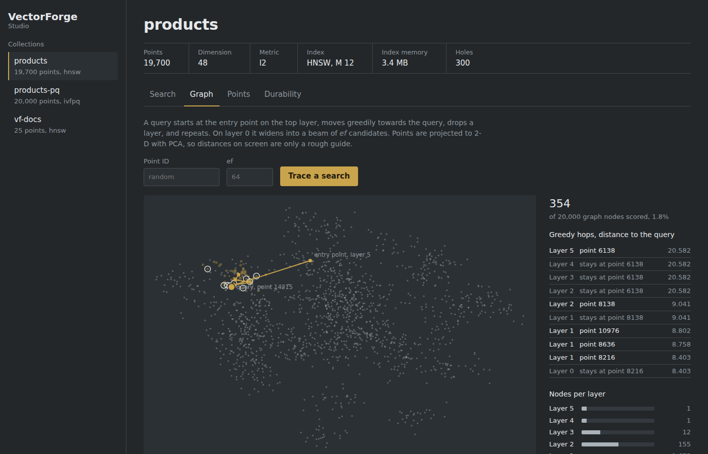
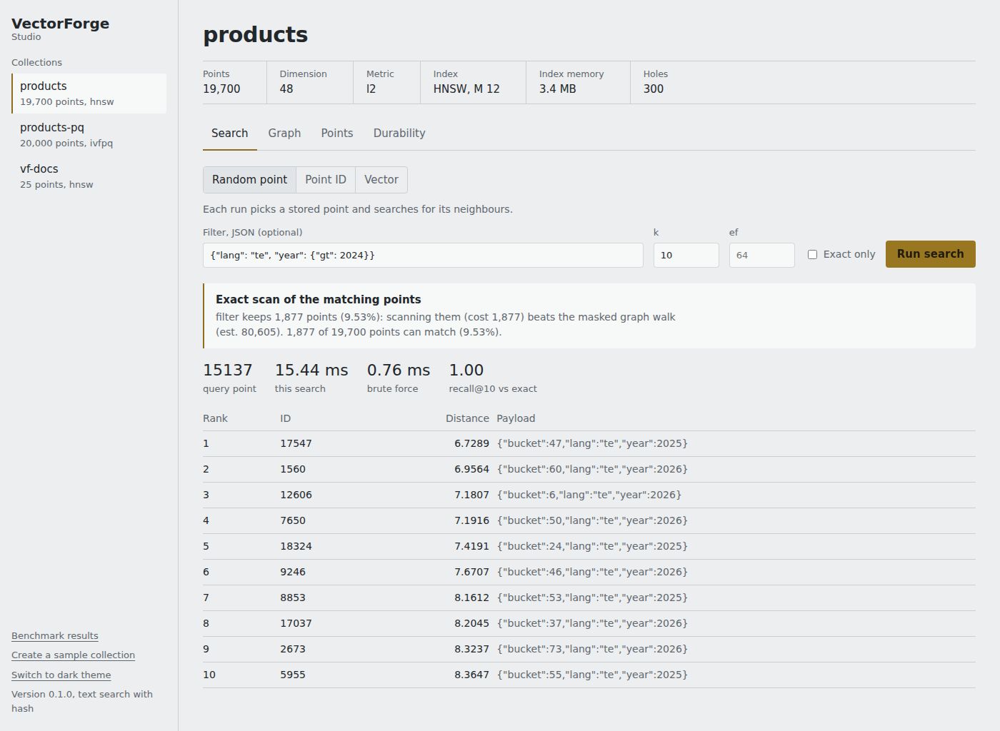
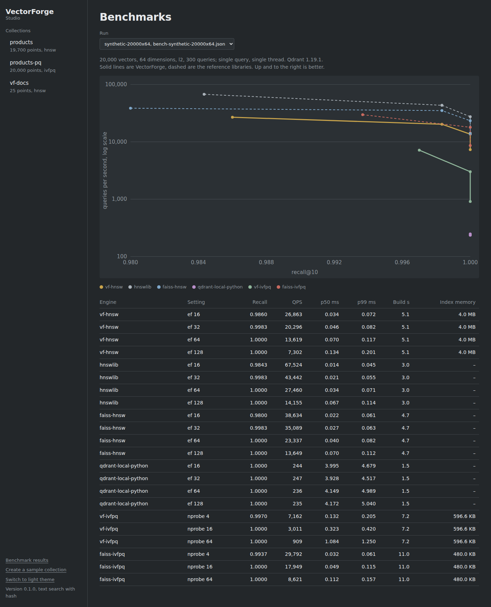
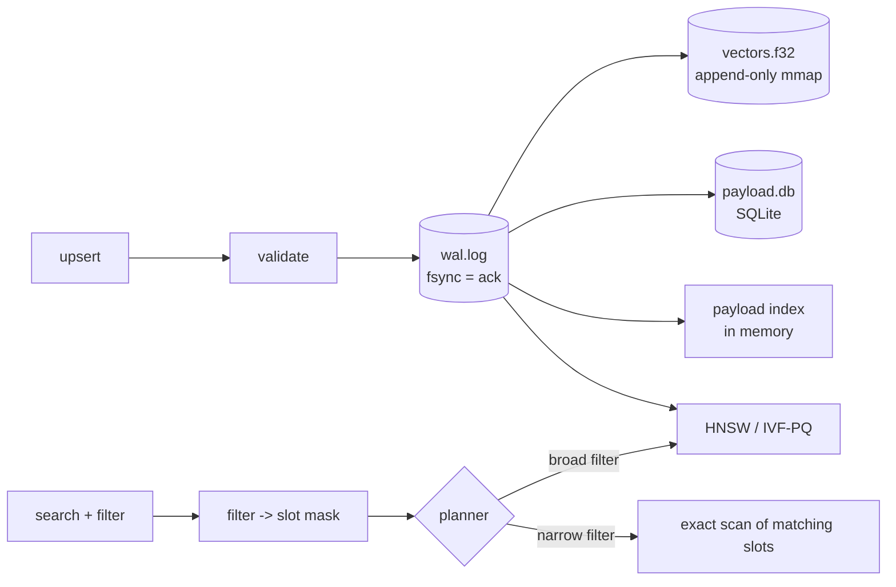

# VectorForge

A small vector database built from first principles: exact, HNSW and IVF-PQ
indexes, filtered search with a cost-based planner, a write-ahead log that
survives `kill -9`, an HTTP API with a built-in Studio, and benchmarks run
against hnswlib, FAISS and Qdrant on the same data and settings. The goal
is to show how approximate nearest-neighbour search works, not just how to
call it.

The engine is built only on NumPy, Numba and SQLite. No FAISS or hnswlib inside.



## Status

| Milestone | Scope | State |
|---|---|---|
| M1 | Collections, upsert/get/delete, flat (exact) index, mmap + SQLite storage | done |
| M2 | HNSW (Numba): incremental inserts, tombstones, rebuild, saved graph | done |
| M3 | IVF-PQ: k-means++, product quantization, ADC, exact re-rank | done |
| M4 | Payload filters, query planner, write-ahead log, checkpoints, crash recovery | done |
| M5 | HTTP API, Python client, Studio, one benchmark harness for all engines | done |
| M6 | LangChain vector store, semantic-search demo (`ingest` + Studio text search) | done |
| Next | SIFT1M / GloVe runs with Qdrant in Docker; faster IVF-PQ scan and HNSW build | |

## Quick start

```bash
python -m venv .venv
.venv/bin/python -m pip install -e ".[dev]"     # Windows: .\.venv\Scripts\python.exe -m pip install -e ".[dev]"
python -m pytest                                # 90 tests, including a SIGKILL test
python -m vectorforge serve                     # Studio at http://127.0.0.1:8000
```

In Studio, click **Create a sample collection** to get 5,000 clustered
vectors with fields to filter on. To search your own documents by meaning:

```bash
python -m vectorforge ingest docs --collection vf-docs     # needs GEMINI_API_KEY
python -m vectorforge serve --embedder gemini
```

Embedded use, no server:

```python
from vectorforge import VectorForge

with VectorForge("./data") as db:
    col = db.create_collection("docs", dim=768, metric="cosine")          # HNSW by default
    col.upsert(ids=[1, 2], vectors=[v1, v2],
               payloads=[{"lang": "te", "year": 2025}, {"lang": "en", "year": 2023}])
    col.search(q, k=10, filter={"lang": "te", "year": {"gt": 2024}})
    col.search(q, k=10, exact=True)                                        # brute force
    col.explain(k=10, filter={"lang": "te"})                               # which plan, and why
```

Over HTTP, `vectorforge.client.Client` has the same methods. With
LangChain, `VectorForgeStore` works as a vector store and retriever
([demo and LangChain](docs/demo.md), [API](docs/api.md)).

## Studio

A console for looking inside the database, served by the API at `/`:

- **Search**: query by a random point, an ID, text or a raw vector, with a
  filter. Shows the plan the planner chose and why, timing next to brute
  force, and recall against the exact answer, with misses marked.
- **Graph** (HNSW): a 2-D PCA map with the query's greedy path down the
  layers, the nodes expanded on layer 0, and how many of all nodes were
  scored. Nodes per layer and the layer-0 degree histogram.
- **Lists** (IVF-PQ): which list centroids a query probes and how many
  compressed points that scans.
- **Points**, **Durability** (log sequence numbers, WAL size, replayed
  records, checkpoint button) and **Benchmarks** (recall vs QPS charts).

| | |
|---|---|
|  |  |

Screenshots use synthetic data and, for text search, the offline hashing
embedder; the benchmark page shows a 20k-vector smoke run, not SIFT1M.

## What has been measured

Single-threaded, same settings as the reference, scored against the same
exact ground truth. Synthetic clustered data, 100k x 128, until the SIFT1M
runs are in.

| | VectorForge | Reference | |
|---|---|---|---|
| HNSW recall@10, ef 32 | 0.999 at 10,559 QPS | hnswlib 0.999 at 23,730 QPS | 2.2x slower, same recall |
| IVF-PQ recall@10, nprobe 16, re-rank 100 | 1.000 at 1,908 QPS | FAISS 1.000 at 8,052 QPS | 4.2x slower, same recall |
| IVF-PQ index memory | 8.6% of raw float32 | | target <= 12.5% |
| Filtered recall@10, 0.1% to 90% selectivity | >= 0.995 | post-filtering: 0.009 at 0.1% | |
| `kill -9` during ingest | 0 acknowledged writes lost | | |

Details, methods and what went wrong along the way are in the
component write-ups listed below.

## Documentation

| | |
|---|---|
| [Product requirements (PRD)](docs/prd.md) | Problem, goals, requirements, milestones, risks |
| [Functional design (FDD)](docs/FDD.md) | How every feature behaves, data design, configuration, errors, and a traceability matrix from each requirement to code and tests |
| [Architecture](docs/architecture.md) | Components and the write, search and recovery flows |
| [Design decisions](docs/design-decisions.md) | 15 decisions, each with the alternative and its cost |
| [HNSW](docs/hnsw.md), [IVF-PQ](docs/ivfpq.md), [filtering](docs/filtering.md), [durability](docs/durability.md) | How each part works, what was measured, what went wrong |
| [API](docs/api.md), [demo and LangChain](docs/demo.md) | Using it |
| [Benchmarks](docs/benchmarks.md), [testing](docs/testing.md) | How it is measured and verified |

## How a write and a search work



## Design decisions

- **Indexes work in slots, not IDs.** The collection maps IDs to slots, so
  any index can be thrown away and rebuilt from the vector file.
- **Vectors are append-only.** Replacing a point writes a new slot. A saved
  index can then be behind after a crash but never wrong, and the payload
  index never needs to delete postings.
- **The WAL is the only thing fsynced per write.** The vector file, SQLite
  and indexes are caches of "last checkpoint + log".
- **Every metric is "higher is better" internally.** Cosine vectors are
  normalised on write; L2 is ranked by negative squared distance.
- **Narrow filters are answered exactly.** The planner compares the cost of
  scanning the matching points with the cost of walking the graph past
  non-matching ones, with constants fitted from the benchmark.

## Repository map

```
vectorforge/engine/        storage, WAL, filters, planner, collection
vectorforge/engine/index/  flat, HNSW (+ Numba kernels), IVF-PQ, k-means
vectorforge/server/        FastAPI app and the Studio page
vectorforge/client.py      HTTP client
vectorforge/integrations/  LangChain vector store
vectorforge/cli.py         serve, ingest
scripts/                   bench.py, bench_filtered.py, get_datasets.py
docs/                      write-ups per component
tests/                     90 tests: recall vs flat, graph invariants, crash recovery, API
bench/                     docker-compose for the Qdrant baseline
.github/workflows/         CI: tests on Ubuntu and Windows
```

## License

MIT. See [LICENSE](LICENSE).
