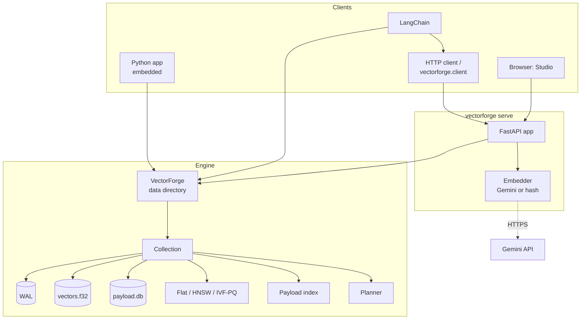

# VectorForge: Functional Design Document

| | |
|---|---|
| Product | VectorForge, a vector database built from scratch |
| Version described | 0.1.0 (milestones M1 to M6) |
| Document version | 1.0, 2026-10-03 |
| Owner | Stef |
| Source of requirements | [PRD](prd.md) |
| Status | Implemented; SIFT1M / GloVe benchmark runs pending |

The PRD says *what* VectorForge must do and why. This document says *how
each feature behaves*: inputs, rules, outputs, errors and limits, precisely
enough to test against. Section 11 traces every PRD requirement to the
features, code and tests that satisfy it.

## Contents

1. [Scope](#1-scope)
2. [Glossary](#2-glossary)
3. [Users and use cases](#3-users-and-use-cases)
4. [System context](#4-system-context)
5. [Functional specification](#5-functional-specification)
6. [Data design](#6-data-design)
7. [Configuration reference](#7-configuration-reference)
8. [Error handling](#8-error-handling)
9. [Non-functional requirements](#9-non-functional-requirements)
10. [Security and privacy](#10-security-and-privacy)
11. [Traceability matrix](#11-traceability-matrix)
12. [Acceptance status](#12-acceptance-status)
13. [Limitations and open items](#13-limitations-and-open-items)
14. [Revision history](#14-revision-history)

---

## 1. Scope

**In scope (v0.1.0)**

- An embeddable Python engine: collections of points (integer ID, float32
  vector, JSON payload) with exact, HNSW and IVF-PQ search.
- Payload filtering evaluated during search, chosen by a cost-based planner.
- Crash-safe persistence: write-ahead log, checkpoints, recovery.
- An HTTP API, a Python client, a CLI, and a browser console (Studio).
- Text ingestion and search through a pluggable embedder (Gemini, or an
  offline hashing embedder for tests).
- A LangChain vector-store adapter.
- A benchmark harness comparing VectorForge with hnswlib, FAISS and Qdrant.

**Out of scope (v0.1.0)**, as in the PRD non-goals: clustering, sharding,
replication, GPU search, multi-tenancy, authentication, rate limits, and
any production stability promise. Hybrid dense + sparse search (FR-11) and
a Rust/SIMD core (FR-12) are deferred.

## 2. Glossary

| Term | Meaning |
|---|---|
| Collection | A named set of points sharing one dimension, metric and index type. |
| Point | `(id, vector, payload)`. ID is an integer in 0..2^63-1. |
| Payload | A JSON object stored with a point. Top-level fields can be filtered on. |
| Slot | Row number of a vector in `vectors.f32`. Indexes store slots, never IDs. |
| Hole | A slot whose point was deleted or replaced. Skipped by every search. |
| Tombstone | An index entry for a hole. Kept for routing (HNSW) until a rebuild. |
| LSN | Log sequence number: the position of a record in the write-ahead log. |
| Checkpoint | The point at which all derived state is durable and the WAL is emptied. Also called the snapshot. |
| Selectivity | Matching live points / all live points, for a filter. |
| recall@k | Fraction of the exact top-k that a search returns. |
| ef | HNSW beam width while searching (`ef_search`) or building (`ef_construction`). |
| nprobe | Number of IVF lists a query opens. |
| Re-rank | Recomputing exact distances for the best compressed candidates. |

## 3. Users and use cases

| Actor | Goal | Entry point |
|---|---|---|
| Application developer | Store and search vectors inside a Python process | `vectorforge.VectorForge` |
| Service client | Use VectorForge over the network | HTTP API, `vectorforge.client.Client` |
| LangChain user | Use VectorForge as a retriever | `VectorForgeStore` |
| Explorer / interviewer | See how searches and indexes behave | Studio at `/` |
| Benchmarker | Compare engines fairly | `scripts/bench.py`, `scripts/bench_filtered.py` |

| ID | Use case | Main flow |
|---|---|---|
| UC-1 | Create a collection | Choose name, dimension, metric, index, settings; collection folder is created. |
| UC-2 | Load points | Upsert batches; each call returns after the batch is in the fsynced WAL. |
| UC-3 | Search | Give a query vector (or text), k, optional filter; get ranked points with scores and payloads. |
| UC-4 | Search with a filter | The planner picks exact scan of matches or masked index search; `explain` shows why. |
| UC-5 | Recover after a crash | Re-open the data directory; un-checkpointed WAL records are replayed automatically. |
| UC-6 | Search documents by meaning | `ingest` a folder, start the server with an embedder, ask questions in Studio. |
| UC-7 | Inspect an index | Studio Graph/Lists tab traces a query through HNSW layers or IVF lists. |
| UC-8 | Benchmark | Run the harness; read recall/QPS/latency/memory per engine in JSON, PNG or Studio. |

## 4. System context



## 5. Functional specification

Each feature lists its behaviour, then the PRD requirement it serves.

### F-1 Collection management (FR-1)

| Operation | Rules |
|---|---|
| Create | `name` matches `^[A-Za-z0-9_-]{1,64}$`. `dim` is an integer in 1..65,536. `metric` is `cosine`, `dot` or `l2`. `index` is `hnsw` (default), `ivfpq` or `flat`. `params` may only contain keys valid for that index (section 7); unknown keys are rejected. For IVF-PQ, `m` must divide `dim`. Settings are written to `collection.json` atomically. An existing name fails. |
| Get / list | Collections are opened lazily and cached. A folder without `collection.json` is not a collection. |
| Info | Returns name, dim, metric, points, slots used, holes, index statistics, WAL size, last LSN, checkpoint LSN, records replayed at open, and payload fields seen. |
| Drop | Closes the collection without checkpointing and deletes its folder. Dropping a missing collection returns false. |

### F-2 Writes: upsert and delete (FR-2)

**Upsert** `upsert(ids, vectors, payloads=None)`

1. Validate: IDs are integers (not bools) in 0..2^63-1; vectors form an
   `(n, dim)` finite float32 matrix; counts match; payloads are dicts that
   serialise to JSON without NaN or infinity. For `cosine`, zero vectors
   are rejected. Invalid input raises and **nothing is logged**.
2. Within one call, if an ID appears more than once, the **last** copy wins.
3. For `cosine`, vectors are L2-normalised before storage.
4. Every point gets a **new slot** at the end of the vector file
   (append-only). An existing ID's old slot becomes a hole.
5. One WAL record is appended and fsynced. **The call is acknowledged
   when this returns.**
6. Apply: write vectors, upsert SQLite rows, update the slot map, payload
   index and ANN index (tombstone old slots, add new ones).
7. If the index's tombstone ratio exceeds 25%, rebuild it from live slots.
   If IVF-PQ is untrained and live points reach `max(train_after, 256)`,
   train it.
8. If the WAL exceeds `wal_max_bytes`, checkpoint.

Returns the number of distinct IDs written.

**Delete** `delete(ids)`: duplicate IDs are ignored; if none of the IDs
exist, nothing is logged and 0 is returned. Otherwise one WAL record is
fsynced, rows are removed from SQLite, slots become holes, the index
tombstones them (and may rebuild), and the count actually deleted is returned.

### F-3 Reads (FR-2)

| Operation | Behaviour |
|---|---|
| `get(ids, with_vectors)` | Results in the order asked; `None` where an ID does not exist. Cosine collections return the stored (normalised) vector. |
| `scroll(after, limit)` | Points in ascending ID order after `after`, at most `limit` (capped at 1,000). Returns the next cursor, or none on the last page. |
| `sample_ids(n)` | Up to n random live IDs (used by Studio's "random point"). |

### F-4 Vector search (FR-3, FR-4, FR-5)

`search(vector, k, *, filter, exact, ef, nprobe, rerank)` and
`search_batch(vectors, k, ...)`.

- `k` must be a positive integer. Fewer than k results are returned when
  fewer points can match.
- Results are sorted best first and carry `id`, `score` and `payload`.
- **Scores:** `cosine` and `dot` return the similarity (higher is closer).
  `l2` returns the Euclidean distance (lower is closer).
- `exact=True` always uses brute force: the recall reference.
- `ef` (HNSW) and `nprobe` / `rerank` (IVF-PQ) override the collection's
  settings for one call.
- An empty collection returns empty result lists.

Index behaviour:

| Index | Search |
|---|---|
| Flat | Scores every live point in 65,536-row chunks, merging a running top-k. Exact. |
| HNSW | Greedy descent from the entry point through upper layers, then a beam search of width `max(ef, k)` on layer 0. Tombstoned or filtered-out nodes are traversed but never returned. |
| IVF-PQ | Score the query against all centroids; open the best `nprobe` lists; score codes with an asymmetric-distance lookup table; keep the best `max(k, rerank)`; recompute exact similarities for them (if `rerank > 0`); return the top k. Until trained, searches are exact. |

### F-5 Filter language (FR-6)

A filter is a non-empty dict of `field -> condition`; all conditions must hold.

| Condition | Example | Matches |
|---|---|---|
| Equality | `{"lang": "te"}` | value equals, or any list element equals |
| `eq` | `{"lang": {"eq": "te"}}` | same as above |
| `in` | `{"lang": {"in": ["te", "en"]}}` | equals any listed value |
| Range | `{"year": {"gt": 2024, "lte": 2026}}` | numeric value within all bounds |

Rules: equality values must be strings, numbers or bools; `in` takes a
list of those; range bounds are finite non-bool numbers; `eq`/`in` cannot
be combined with other operators. `1`, `1.0` and `true` are distinct for
matching purposes (`true` does not match `1`). Ranges apply to scalar
numbers only; strings that look like numbers do not match a range. Only
top-level fields are indexed. A filter on a missing field matches nothing.
Invalid filters are rejected with a message naming the field.

### F-6 Query planning (FR-6)

The planner computes `candidates` (live points matching the filter) and
`selectivity = candidates / live`, then chooses:

| Situation | Strategy |
|---|---|
| No candidates | `empty` |
| `exact=True` or flat index | `flat_scan` (no filter) or `subset_scan` (filter) |
| IVF-PQ not trained | `flat_scan` / `subset_scan` |
| HNSW with filter | `subset_scan` if `candidates <= 5 x ef x 2M / selectivity`, else `hnsw` with the mask |
| HNSW, no filter | `hnsw` |
| IVF-PQ with filter | `subset_scan` if `candidates <= 20,000` or `selectivity <= 2%`, else `ivfpq` with `nprobe / selectivity` |
| IVF-PQ, no filter | `ivfpq` |

`explain(...)` returns the plan (`strategy`, human-readable `reason`,
`candidates`, `live`, `selectivity`, `params`) without searching. The HNSW
cost constant 5 was fitted from `scripts/bench_filtered.py`
([filtering.md](filtering.md)).

### F-7 Durability (FR-7)

| Event | Behaviour |
|---|---|
| Write | WAL record appended, flushed, fsynced (if `fsync: true`), then applied. |
| Checkpoint | (1) flush and fsync `vectors.f32`; (2) SQLite `wal_checkpoint(FULL)`; (3) save the index atomically; (4) write `checkpoint.json` with the last LSN atomically; (5) empty the WAL. Triggered by WAL size, `close()`, after recovery, or on request. |
| Open | Read the WAL; stop at the first record with a bad length, op or CRC and truncate the file there; replay records with LSN > checkpoint LSN; build in-memory state from SQLite; load and catch up the index; checkpoint if anything was replayed. |
| Guarantee | With `fsync: true`, every acknowledged write survives a process kill and a loss of un-synced vector-file and SQLite state. |

Replay is idempotent because every record is a blind write (section 6.3).

### F-8 Index lifecycle (FR-4, FR-5)

- **HNSW build:** incremental; each inserted node draws a level
  `floor(-ln(U) / ln(M))` (max 15) and is linked with the neighbour-selection
  heuristic. Layer 0 allows `2M` links, upper layers `M`.
- **IVF-PQ training:** automatic once live points reach
  `max(train_after, 256)`, on a sample of up to `train_size` live vectors;
  `nlist` defaults to `clamp(4 sqrt(n), 16, 65536)` capped at `n / 39`; `m`
  defaults to the largest divisor of dim that is <= dim/4.
  `train_index()` retrains on current data.
- **Tombstones and rebuild:** deletes and replacements tombstone slots;
  above a 25% tombstone ratio the index is rebuilt from live slots
  (synchronously, inside the write call).
- **Persistence:** the index is saved at each checkpoint (`hnsw.npz` /
  `ivfpq.npz`). On open, a saved index whose settings do not match is
  discarded and rebuilt. A matching one is loaded and caught up: slots
  that died since are tombstoned, slots added since are inserted.

### F-9 HTTP API (FR-8)

Full endpoint list: [api.md](api.md). Behaviour beyond the engine's:

- Search accepts exactly one query source: `vector`, `text` (requires a
  server embedder whose dimension matches the collection), `query_id` (a
  stored point's vector) or `random: true`.
- `compare_exact: true` also runs brute force and returns its hits, time
  and the recall of the main search.
- `/inspect` returns HNSW nodes per layer and the layer-0 degree histogram,
  or IVF list sizes. `/inspect/trace` returns a PCA projection of up to
  `sample` points plus the query's HNSW hops, layer-0 expansions and
  results, or its probed IVF lists.
- `/benchmarks` lists readable JSON files in the results directory;
  unreadable files are skipped.
- On start-up the server compiles/loads the Numba kernels on a tiny index
  so the first real request isn't slowed by it. On shutdown every open
  collection is checkpointed.

### F-10 Python client (FR-8)

`Client(url)` / `Client(http=httpx_client)` exposes `create_collection`,
`get_collection`, `list_collections`, `drop_collection` and `health`.
`RemoteCollection` mirrors `Collection`: `upsert` (batched, default 1,000
points per request), `get`, `delete`, `search`, `search_batch`, `explain`,
`checkpoint`, `train_index`, `info`, `len()`. Return types are the engine's
`Point` and `ScoredPoint`. HTTP errors raise `VectorForgeError(status, detail)`.

### F-11 CLI

| Command | Behaviour |
|---|---|
| `python -m vectorforge serve [--data] [--results] [--host] [--port] [--embedder gemini\|hash\|none]` | Runs the API and Studio (default 127.0.0.1:8000). |
| `python -m vectorforge ingest PATH [--collection] [--data] [--embedder] [--chunk]` | Reads `.md`, `.txt`, `.rst` under PATH; splits on blank lines into chunks of at most `--chunk` characters (default 900); embeds; upserts with payload `{source, chunk, text}` into a cosine collection (created if missing, sized to the embedder). Chunk ID = 53-bit hash of its text, so re-ingesting is idempotent. |

### F-12 Studio (UI)

A single static page served at `/`, using only the public API.

| View | Shows | Actions |
|---|---|---|
| Sidebar | Collections with point count and index type | Open a collection; open Benchmarks; create a sample collection (5,000 clustered 32-d vectors with `bucket`, `lang`, `year`); switch theme |
| Facts strip | Points, dimension, metric, index, index memory, holes | |
| Search | Plan and reason, search time, brute-force time, recall vs exact, results with misses marked | Query by random point, ID, text (if embedder), or vector; filter; k; ef/nprobe; exact |
| Graph (HNSW) | PCA map: sample points, greedy path with hops, layer-0 expansions, top 10; hop list; nodes per layer; degree histogram; share of nodes scored | Trace a random or chosen point at a chosen ef |
| Lists (IVF-PQ) | PCA map of centroids with probed lists highlighted; list-size histogram; share of points scanned | Choose point and nprobe |
| Points | ID and payload, 50 per page | Next / first page |
| Durability | Last LSN, checkpoint LSN, writes only in the log, WAL size, records replayed at open | Checkpoint now |
| Benchmarks | Recall vs QPS chart (log scale) per engine; full results table | Choose a results file |

Empty and error states tell the user what to do next. Light and dark
themes follow the system setting and can be switched; the layout works
down to phone width.

### F-13 Text embedding

| Embedder | Behaviour |
|---|---|
| `gemini` | `gemini-embedding-001` through the REST batch endpoint, 768 dimensions, up to 100 texts per request, `RETRIEVAL_DOCUMENT` for stored text and `RETRIEVAL_QUERY` for questions. Needs `GEMINI_API_KEY` (or `GOOGLE_API_KEY`). |
| `hash` | Offline, deterministic, 256-d, signed hashing of words and character trigrams, L2-normalised. Lexical, not semantic: for tests and demos without a key. |

### F-14 LangChain adapter (FR-10)

`VectorForgeStore(collection, embeddings)` implements LangChain's
`VectorStore`: `add_texts`, `add_documents`, `delete`, `get_by_ids`,
`similarity_search[_with_score]`, `similarity_search_by_vector[_with_score]`,
relevance scores, `as_retriever`, and `from_texts` (embedded with
`data_dir`, or remote with `url`). LangChain string IDs map to 53-bit
integers by hashing; random UUIDs are used when none are given. Metadata is
stored at the payload's top level so `filter=` uses F-5 directly; the keys
`page_content` and `_lc_id` are reserved and rejected in metadata.
Relevance: cosine `(s + 1) / 2`, L2 `1 / (1 + d)`.

### F-15 Benchmark harness (FR-9)

`scripts/bench.py` loads an ann-benchmarks HDF5 file (or synthetic data),
builds each selected engine with matched settings, sweeps `ef` or `nprobe`,
sends queries one at a time on one thread, and records per setting:
recall@k, QPS (1 / mean latency), p50 and p99 latency, build time and
index memory where measurable. Output: `results/bench-<dataset>.json`
(including machine details and the Qdrant server version) and a PNG chart.
`scripts/bench_filtered.py` compares post-filtering, masked HNSW, subset
scan and the planner across selectivities. Method: [benchmarks.md](benchmarks.md).

## 6. Data design

### 6.1 Files per collection

```
data/collections/<name>/
  collection.json    settings (written once, atomically)
  wal.log            records since the last checkpoint
  checkpoint.json    {"lsn": N}
  vectors.f32        float32 rows; row = slot; grows by doubling
  payload.db         SQLite (WAL journal mode, synchronous=NORMAL)
  hnsw.npz | ivfpq.npz
```

`collection.json` example:

```json
{
  "name": "docs", "dim": 768, "metric": "cosine",
  "index": {"type": "hnsw", "M": 16, "ef_construction": 200, "ef_search": 64},
  "storage": {"fsync": true, "wal_max_bytes": 67108864}
}
```

### 6.2 SQLite schema

```sql
CREATE TABLE meta   (key TEXT PRIMARY KEY, value TEXT NOT NULL);   -- next_slot
CREATE TABLE points (id INTEGER PRIMARY KEY,
                     slot INTEGER NOT NULL UNIQUE,
                     payload TEXT NOT NULL);                      -- JSON
```

### 6.3 WAL record

```
u32 body_len | u32 crc32(lsn, op, body) | u64 lsn | u8 op | body      (little-endian)

op 1 UPSERT: u32 n | i64 ids[n] | i64 slots[n] | f32 vectors[n*dim] | n x (u32 len | utf-8 JSON)
op 2 DELETE: u32 n | i64 ids[n]
```

Records state outcomes ("ID 5 is at slot 812 with this payload", "ID 5 is
gone"), never increments, so replaying an already-applied suffix converges
to the same state.

### 6.4 In-memory structures

| Structure | Purpose |
|---|---|
| `slot_ids` (int64 per slot, -1 = hole) | Slot -> ID mapping and the live mask |
| Payload index | Postings `(field, typed value) -> slots`; numeric columns `field -> float64[slot]` (NaN = missing) |
| HNSW arrays | `level0 (N, 2M)`, `upper (rows, 16, M)`, `upper_row`, `node_level`, `deleted`, `visited` stamps |
| IVF-PQ | centroids `(nlist, d)`, codebooks `(m, 256, d/m)`, per list: slot IDs (int32) and codes `(n, m)` uint8 |

## 7. Configuration reference

| Setting | Default | Notes |
|---|---|---|
| HNSW `M` | 16 | Links per node; layer 0 allows 2M |
| HNSW `ef_construction` | 200 | Raised to at least M |
| HNSW `ef_search` | 64 | Per-call override `ef` |
| IVF-PQ `nlist` | auto | `clamp(4 sqrt(n), 16, 65536)`, at most n/39 |
| IVF-PQ `m` | auto | Largest divisor of dim <= dim/4 |
| IVF-PQ `nprobe` | 16 | Per-call override |
| IVF-PQ `rerank` | 100 | 0 disables exact re-rank |
| IVF-PQ `train_size` | 100,000 | Training sample size |
| IVF-PQ `train_after` | 10,000 | Never below 256 |
| Storage `fsync` | true | false keeps consistency but not durability |
| Storage `wal_max_bytes` | 64 MiB | Checkpoint threshold |
| Rebuild threshold | 25% tombstones | Constant |
| Planner HNSW cost factor | 5.0 | Constant, fitted |
| Planner IVF subset limits | 20,000 points or 2% | Constants, not yet calibrated |

## 8. Error handling

| Condition | Engine | HTTP |
|---|---|---|
| Invalid name, dimension, metric, index, setting | `ValueError` | 400 |
| Wrong vector dimension, NaN/inf, zero vector under cosine | `ValueError` | 400 |
| Non-integer or out-of-range ID, non-dict payload | `TypeError` / `ValueError` | 400 |
| Invalid filter | `ValueError` naming the field | 400 |
| `k < 1` | `ValueError` | 400 |
| Text query without an embedder, or dimension mismatch | | 400 |
| Unknown collection or query point | `KeyError` | 404 |
| Collection already exists | `FileExistsError` | 409 |
| Torn or corrupt WAL tail | Truncated silently at open; earlier records kept | |
| Saved index incompatible with settings | Discarded and rebuilt at open | |
| Gemini API error | `RuntimeError` with status and message | 500 |

## 9. Non-functional requirements

| Area | PRD target | Status |
|---|---|---|
| HNSW recall@10 | >= 0.95 on SIFT1M | 0.999 on 100k synthetic; SIFT1M pending |
| HNSW vs hnswlib | QPS within 3x at equal recall | 2.2-2.7x on 100k synthetic (batch); SIFT1M pending |
| HNSW latency | p50 <= 2 ms, p99 <= 10 ms | p50 0.03-0.13 ms, p99 0.07-0.20 ms on the 20k smoke run; SIFT1M pending |
| HNSW build | <= 15 min for 1M | 1,530 vectors/s at 100k (~11+ min extrapolated); at risk |
| IVF-PQ memory | <= 1/8 of raw | 8.6% of raw on 100k |
| IVF-PQ recall@10 | >= 0.90 with re-rank 100 | 1.000 on 100k synthetic |
| Durability | kill -9 loses no acknowledged write | Met (test) |
| Filtered recall@10 | >= 0.90 at 1% selectivity | 1.000 (planner uses exact scan) |
| Test coverage | >= 85% on engine | 90 tests; coverage not yet measured |

## 10. Security and privacy

The server binds to 127.0.0.1 by default and has **no authentication**
(PRD non-goal). Do not expose it to a network. Payloads and ingested text
are stored unencrypted in the data directory. With the Gemini embedder,
ingested text and queries are sent to Google's API. The API key is read
from the environment and never stored.

## 11. Traceability matrix

| PRD | Feature | Code | Tests | Status |
|---|---|---|---|---|
| FR-1 Collections | F-1 | `db.py`, `engine/collection.py` | `test_create_list_drop`, `test_bad_names`, `test_bad_dimension_and_metric`, `test_collection_crud_and_errors` | Done |
| FR-2 Points | F-2, F-3 | `engine/collection.py`, `payload_store.py`, `vector_store.py` | `test_upsert_get_delete`, `test_upsert_replaces_via_new_slot`, `test_duplicate_ids_in_batch_last_wins`, `test_validation`, `test_persistence_across_reopen` | Done |
| FR-3 Flat index | F-4 | `engine/index/flat.py` | `test_matches_naive`, `test_k_larger_than_allowed_pads`, `test_search_matches_brute_force_at_scale` | Done |
| FR-4 HNSW | F-4, F-8 | `engine/index/hnsw.py`, `_hnsw_kernels.py` | `test_recall_vs_flat`, `test_graph_invariants`, `test_tombstones_and_filters`, `test_save_load_roundtrip`, `test_crash_catch_up`, `test_rebuild_after_many_deletes` | Done |
| FR-5 IVF-PQ | F-4, F-8 | `engine/index/ivfpq.py`, `kmeans.py` | `test_recall_with_rerank`, `test_memory_is_a_fraction_of_raw`, `test_collection_lifecycle`, `test_kmeans_*` | Done |
| FR-6 Filtering | F-5, F-6 | `engine/filters.py`, `planner.py` | `test_invalid_filters`, `test_payload_index_semantics`, `test_filtered_search_recall_and_plan`, `test_planner_edge_cases`, `test_filter_sees_updates_and_deletes` | Done |
| FR-7 Durability | F-7 | `engine/wal.py`, `collection.py` | `test_kill_9_loses_no_acknowledged_write`, `test_replay_after_losing_unsynced_state`, `test_replay_is_idempotent`, `test_wal_*`, `test_*checkpoint*` | Done |
| FR-8 API + client | F-9, F-10, F-11 | `server/app.py`, `client.py`, `cli.py` | `test_server.py` (7 tests), `test_cli.py` | Done |
| FR-9 Benchmarks | F-15 | `scripts/bench.py`, `bench_filtered.py` | Smoke run (synthetic, all adapters) | Harness done; SIFT1M/GloVe runs pending |
| FR-10 Integrations | F-13, F-14, F-12 | `integrations/langchain.py`, `embeddings.py`, `server/static/index.html` | `test_langchain.py`, `test_text_demo_endpoints`, `test_ingest_with_offline_embedder` | Done (LangChain; LlamaIndex not built) |
| FR-11 Hybrid search | | | | Deferred |
| FR-12 Rust/SIMD core | | | | Deferred |

## 12. Acceptance status

| PRD success criterion | Status |
|---|---|
| HNSW >= 0.95 recall@10 on SIFT1M within 3x of hnswlib QPS | Pending SIFT1M run; met on synthetic 100k |
| Recall-QPS chart and design write-up in the README | Write-ups done; chart pending real data |
| Demo app runs semantic search end to end, installed with one pip command | Done: `pip install -e .`, `ingest`, `serve --embedder gemini` |
| Stef can whiteboard HNSW insert/search and PQ encoding without notes | Owner's call; [hnsw.md](hnsw.md) and [ivfpq.md](ivfpq.md) are the study notes |

## 13. Limitations and open items

- **Benchmarks:** all published numbers are synthetic or from a test
  container; SIFT1M and GloVe runs with Qdrant in Docker are next.
- **IVF-PQ speed:** probed lists are walked from Python (one Numba call per
  list), about 4x slower than FAISS; move the per-query loop into one kernel.
- **HNSW build speed:** 2.4x slower than hnswlib; reuse search buffers
  instead of allocating per insert.
- **Rebuilds are synchronous:** a delete that crosses the 25% threshold
  blocks until the index is rebuilt; at 1M points that is minutes.
- **Holes are never reclaimed:** the vector file only grows; compaction is
  not implemented.
- **IVF planner rule** is a fixed threshold, not calibrated like HNSW's.
- **IVF centroid drift:** auto-training happens on early data; call
  `train_index()` after a bulk load.
- **Concurrency:** one lock per collection serialises reads and writes.
- **JSON transport:** vectors over HTTP are JSON lists; a binary route
  would cut ingest bandwidth about tenfold.
- **Filters** are ANDs of top-level fields; no OR, NOT or nested fields.
- **Inner product** with un-normalised vectors gives lower HNSW recall
  (shared with hnswlib; documented in [hnsw.md](hnsw.md)).
- **Not covered by tests:** a disk that ignores fsync, and corruption of
  data files before the last checkpoint.

## 14. Revision history

| Version | Date | Change |
|---|---|---|
| 1.0 | 2026-10-03 | First version, describing v0.1.0 (M1-M6) |
