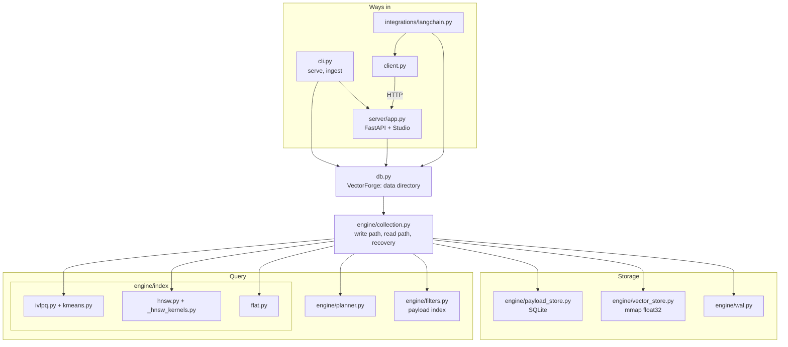
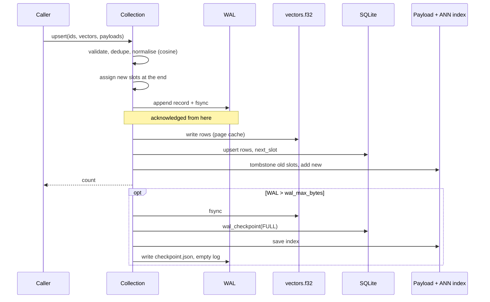
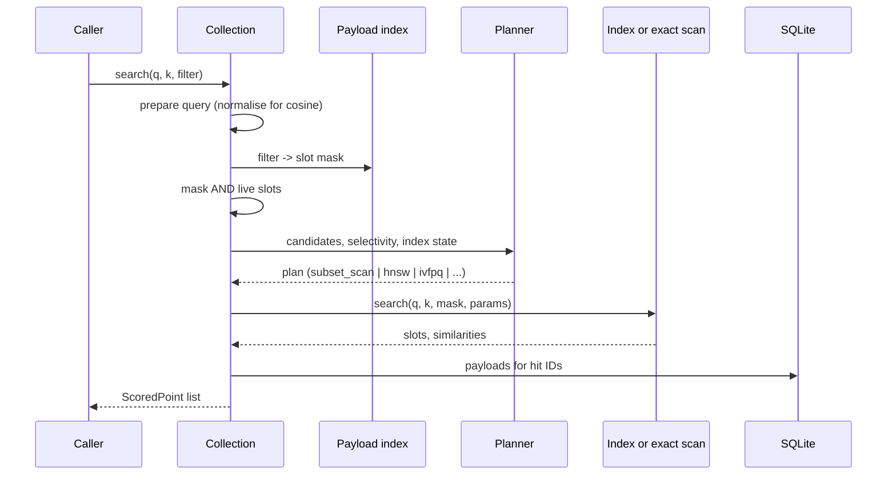
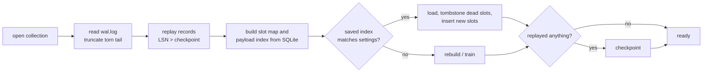
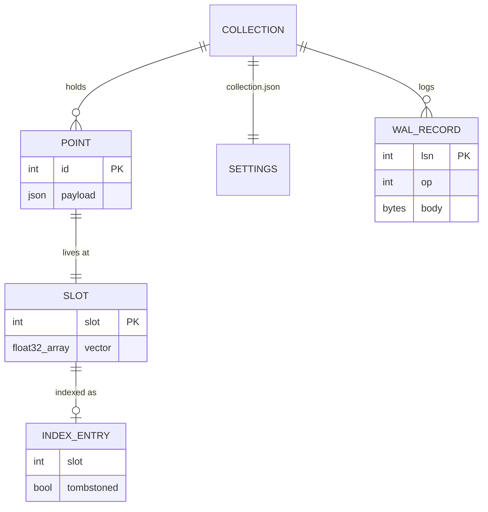

# Architecture

## Components

Every index implements one interface (`engine/index/base.py`): `add`,
`remove`, `search`, `rebuild`, `save`, `load`, `in_index`, `stats`. The
collection and the planner never depend on which index is behind it.

## Write path

## Search path

## Open and recovery

## Data model

## Concurrency

One re-entrant lock per collection serialises writes, searches and
checkpoints. The HTTP server runs request handlers in a thread pool, so
different collections proceed in parallel; requests to one collection are
serialised. Numba kernels release no locks of their own. This is the
simplest correct model; readers-writer locking is listed in
[FDD section 13](FDD.md#13-limitations-and-open-items).
